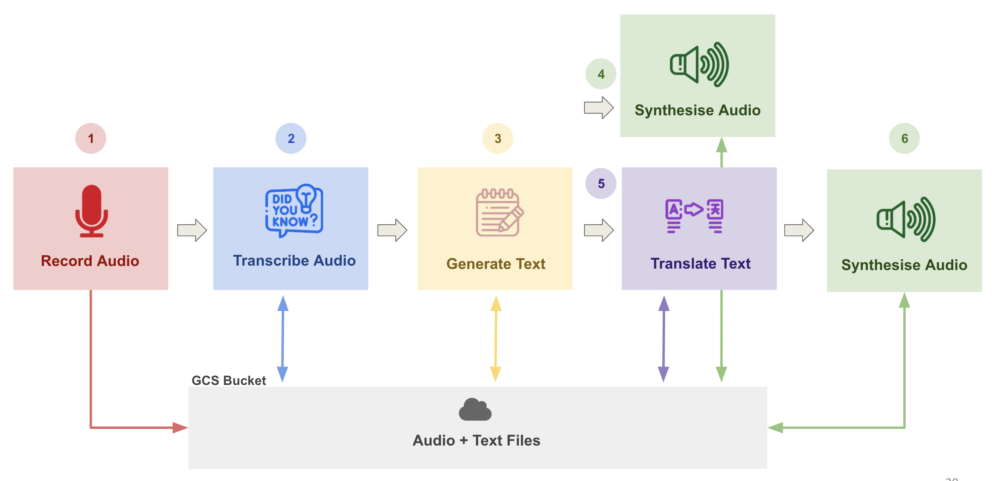
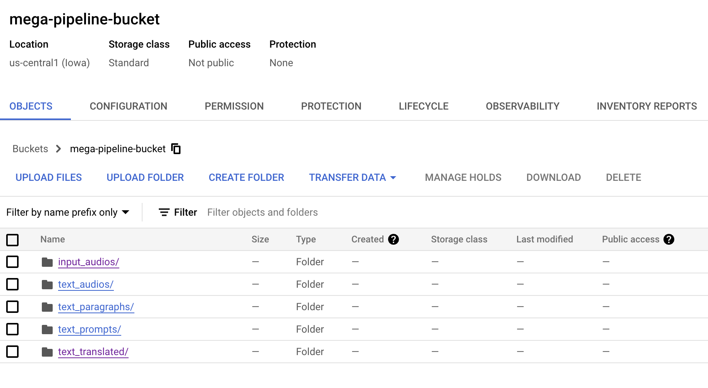

# Mega Pipeline App

Based on the AC215 mega-pipeline tutorial ([dlops-io/mega-pipeline](https://github.com/dlops-io/mega-pipeline)).

🎙️ → 📝 → 🗒️ → [🔊🇫🇷] → 🔊

The goal of this tutorial is to build an **AI-assisted podcast generator** that works across multiple languages. Starting from a **recorded** draft, we'll **transcribe** it, enrich it with an LLM, **translate** it, and **synthesize** the result back into audio.

The key idea is to **simulate a microservice architecture**, where each component runs as its own containerized service. The full pipeline is shown below.

1. Pavlos recorded a draft podcast in English, which serves as our starting point.
2. The audio file is transcribed using the **Google Cloud Speech-to-Text API**.
3. The resulting text is sent to an LLM to generate an expanded version of the podcast.
4. The generated text is synthesized into audio with **Google Cloud Text-to-Speech**.
5. The text is also translated into French (or another language) using **Google Translation** services.
6. The translated text is synthesized into audio again with Google Cloud Text-to-Speech.
7. **Bonus step**: The translated text can also be synthesized with ElevenLabs to recreate Pavlos' voice.

The pipeline flow is illustrated below:


---

## Prerequisites

Complete **[Tutorial 0 - Setup & Installs](https://github.com/dlops-io/ac215-setup)** first. It covers everything this tutorial assumes: a GCP account + project, VS Code, Git, Docker Desktop, and `uv`. You will also need the [Google Cloud CLI](https://cloud.google.com/sdk/docs/install) (`gcloud`).

---

## Clone this Repository

```bash
git clone https://github.com/VinayakMokashi/cheese-podcast-pipeline.git
cd cheese-podcast-pipeline
```

Each of the five components lives in its own subfolder here (`transcribe_audio/`, `generate_text/`, ...), and the results viewer lives in `website/`.

---

## What You'll Learn
By completing this tutorial, you'll gain experience with:
- **Containerizing AI/ML workflows** step by step.
- **Using shared cloud storage (GCS)** to connect independent services.
- **Securing applications** with service account authentication.
- **Calling managed Google Cloud AI APIs** (Speech-to-Text for transcription, Translate for cross-language conversion, and Text-to-Speech for audio synthesis) from inside your containers.

---

## Connecting the Pipeline Components
In a production pipeline, containerized services talk to each other through APIs, sending requests and responses directly between microservices.

Here, instead of calling one another directly, components **communicate indirectly by writing their outputs to storage**, which the next stage then reads as input.

Rather than just using your local disk, components write to and read from a **Google Cloud Storage (GCS)** bucket. This shared bucket acts like a common drive for transcripts, generated text, and synthesized audio.

### GCS Bucket Details
In Google Cloud, a **bucket** is like a shared online folder where files can be stored and retrieved. Instead of saving outputs locally, the pipeline components write and read to this shared bucket so all stages can communicate easily.

- `input_audios/` — raw audio files (starting point).
- `text_prompts/` — transcripts generated from speech-to-text.
- `text_paragraphs/` — expanded text generated by the LLM.
- `text_translated/` — translated versions of the text.
- `text_audios/` — synthesized English audio clips for each paragraph.
- `output_audios/` — final synthesized audio outputs in the target language.
- `output_audios_pp/` — bonus: audio outputs synthesized with ElevenLabs in Pavlos' voice.



Want to learn more about GCS?
- [Google Cloud Storage](https://www.youtube.com/watch?v=VDBhvexAj8I)
- [Google Cloud Storage Overview](https://cloud.google.com/storage)

---

## GCP Setup

The pipeline needs a bucket and a **Service Account** (part of IAM in GCP) that can read and write the bucket and call the AI APIs. With `gcloud`:

```bash
PROJECT=your-project-id
BUCKET=your-bucket-name
SA=mega-pipeline@$PROJECT.iam.gserviceaccount.com
gcloud config set project $PROJECT

# APIs used by the pipeline
gcloud services enable storage.googleapis.com speech.googleapis.com aiplatform.googleapis.com texttospeech.googleapis.com translate.googleapis.com iam.googleapis.com

# Bucket
gcloud storage buckets create gs://$BUCKET --location=us-central1 --uniform-bucket-level-access --public-access-prevention

# Service account with access to the bucket and the AI APIs
gcloud iam service-accounts create mega-pipeline
gcloud storage buckets add-iam-policy-binding gs://$BUCKET --member="serviceAccount:$SA" --role="roles/storage.objectAdmin"
gcloud storage buckets add-iam-policy-binding gs://$BUCKET --member="serviceAccount:$SA" --role="roles/storage.legacyBucketReader"
for ROLE in roles/speech.client roles/aiplatform.user roles/cloudtranslate.user; do
  gcloud projects add-iam-policy-binding $PROJECT --member="serviceAccount:$SA" --role="$ROLE" --condition=None
done

# Key file for the service account
gcloud iam service-accounts keys create mega-pipeline.json --iam-account="$SA"
```

Upload the recorded draft to `input_audios/`. File names must start with `input-` (for example `input-02.mp3`):

```bash
gcloud storage cp input-02.mp3 gs://$BUCKET/input_audios/
```

## GCP Credentials File

Place the `mega-pipeline.json` key inside the `secrets/` folder of each component you run, and of `website/`:

```
<component>/secrets/mega-pipeline.json
```

### 🔑 Important Note on Secrets

We do not want to put this JSON file in GitHub — it is a secret, after all.
Every `secrets/` folder is listed in `.gitignore`, so the key is never committed, and in `.dockerignore`, so it is never copied into an image. The containers read it at run time through a volume mount.

---

## Configuration

Set your own values at the top of each component's `cli.py`:

```python
gcp_project = "your-project-id"
bucket_name = "your-bucket-name"
group_name = "your-group-name"   # outputs are stored under <folder>/<group_name>/
```

---

## 🚀 The Five Components

Each component below has its own folder, its own container, and its own step-by-step `README`. Run them **in this order**; each one reads from the bucket what the previous one wrote:

- 📝 Task A — [transcribe_audio](transcribe_audio)
- 🗒️ Task B — [generate_text](generate_text)
- 🔊 Task C — [synthesis_audio_en](synthesis_audio_en)
- 🇫🇷 Task D — [translate_text](translate_text)
- 🔊 Task E — [synthesis_audio](synthesis_audio)

---

## Option 1: Running Each Component Individually

From inside a component's folder, build its image and open a shell in its container:

```bash
cd transcribe_audio
docker build -t transcribe_audio .
docker run --rm -ti -v "$(pwd):/app" transcribe_audio
```

Once you're inside each component's container, you'll drive it through `cli.py`. The flag names (`--download`, `--transcribe`, `--generate`, `--translate`, `--synthesis`, `--upload`) should make the intent obvious: pull inputs from the bucket, run the component, push outputs back.

**Transcribe Audio**
```bash
python cli.py --download
python cli.py --transcribe
python cli.py --upload
```

**Generate Text**
```bash
python cli.py --download
python cli.py --generate
python cli.py --upload
```

**Synthesize Audio (English)**
```bash
python cli.py --download
python cli.py --synthesis
```
> Note: synthesis writes audio directly to GCS — no separate `--upload` step needed.

**Translate Text**
```bash
python cli.py --download
python cli.py --translate
python cli.py --upload
```

**Synthesize Audio (Translated)**
```bash
python cli.py --download
python cli.py --synthesis
```
> Note: synthesis writes audio directly to GCS — no separate `--upload` step needed.

**Synthesize Audio with ElevenLabs (Bonus)**

`cli_11.py` in `synthesis_audio/` uses the [ElevenLabs API](https://elevenlabs.io/) to synthesize the translated text in **Pavlos' voice**. Create an API key at ElevenLabs and save it in `synthesis_audio/secrets/11lab_api_key.txt`:
```
XI_API_KEY=your_api_key_here
```
Then, inside the `synthesis_audio` container:
```bash
python cli_11.py --download
python cli_11.py --synthesis
python cli_11.py --upload
```
> Note: unlike `cli.py`, `cli_11.py` saves audio **locally first** then uploads to GCS via `--upload`.

---

## Option 2: Running the Whole Pipeline with Docker Compose

From the repository root:

```bash
docker compose up --build
```

`compose.yaml` builds every image and runs the five components in order. Each component starts only after the one it depends on has finished successfully; Synthesize Audio (English) and Translate Text run in parallel. The results viewer starts at **http://localhost:8090**.

To include the ElevenLabs bonus step (needs `synthesis_audio/secrets/11lab_api_key.txt`):

```bash
docker compose --profile elevenlabs up --build
```

To stop and remove everything:

```bash
docker compose down
```

---

## Viewing the Results

`website/` is a small FastAPI app that shows every stage of the pipeline side by side (text, plus audio players) read live from the bucket. It starts automatically with Docker Compose. To run it on its own:

```bash
cd website
docker build -t website .
docker run --rm -p 127.0.0.1:8090:9100 -v "$(pwd)/secrets:/app/secrets:ro" website
```

Then open **http://localhost:8090**. The bucket and group it shows can be changed with `-e BUCKET_NAME=...` and `-e GROUP_NAME=...`.

---

## Appendix

### Sample Dockerfile

```dockerfile
# Use the official Debian-hosted Python image
FROM python:3.12-slim-bookworm

ARG DEBIAN_PACKAGES="build-essential curl"

# Prevent apt from showing prompts
ENV DEBIAN_FRONTEND=noninteractive

# Python wants UTF-8 locale
ENV LANG=C.UTF-8

# Tell Python to disable buffering so we don't lose any logs.
ENV PYTHONUNBUFFERED=1

# Tell uv to copy packages from the wheel into the site-packages
ENV UV_LINK_MODE=copy
ENV UV_PROJECT_ENVIRONMENT=/home/app/.venv

# This is done for the tutorial only
ENV GOOGLE_APPLICATION_CREDENTIALS=secrets/mega-pipeline.json

# Ensure we have an up to date baseline, install dependencies and
# create a user so we don't run the app as root
RUN set -ex; \
    for i in $(seq 1 8); do mkdir -p "/usr/share/man/man${i}"; done && \
    apt-get update && \
    apt-get upgrade -y && \
    apt-get install -y --no-install-recommends $DEBIAN_PACKAGES && \
    apt-get clean && \
    rm -rf /var/lib/apt/lists/* && \
    pip install --no-cache-dir --upgrade pip && \
    pip install uv && \
    useradd -ms /bin/bash app -d /home/app -u 1000 && \
    mkdir -p /app && \
    chown app:app /app

# Switch to the new user
USER app
WORKDIR /app

# Copy the source code
COPY --chown=app:app . ./

RUN uv sync

# Entry point
ENTRYPOINT ["/bin/bash"]
# Get into the uv virtual environment shell
CMD ["-c", "source /home/app/.venv/bin/activate && exec bash"]
```

### Notes for running on Windows
* Run docker commands from **Git BASH** (Windows `cmd` and PowerShell quote arguments differently and will mangle the volume-mount syntax).
* **Always quote `$(pwd)`** — Windows paths often contain spaces (e.g. `C:\Users\First Last\...`), and without quotes the shell splits the path mid-argument.
* Use **`$(pwd -W)`** instead of `$(pwd)` in volume mounts. Git BASH otherwise rewrites the `/app` part of `"$(pwd):/app"` into a Windows path (`C:\Program Files\Git\app`) before Docker sees it.
* If you see `the input device is not a TTY`, prefix the command with `winpty`. Git BASH on Windows doesn't expose a real TTY to Docker, and `winpty` is the shim that fixes it.
* Putting it all together, the run command becomes:
  ```bash
  winpty docker run --rm -ti -v "$(pwd -W):/app" generate_text
  ```
* Docker Compose reads the paths in `compose.yaml` itself, so none of this applies to `docker compose up`.
